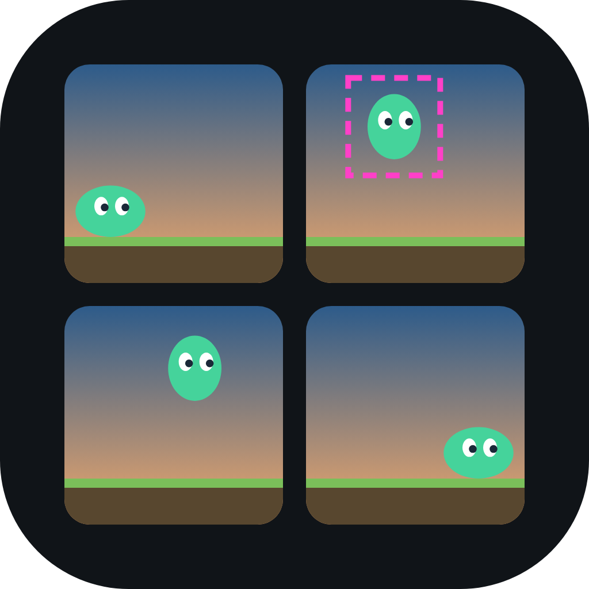
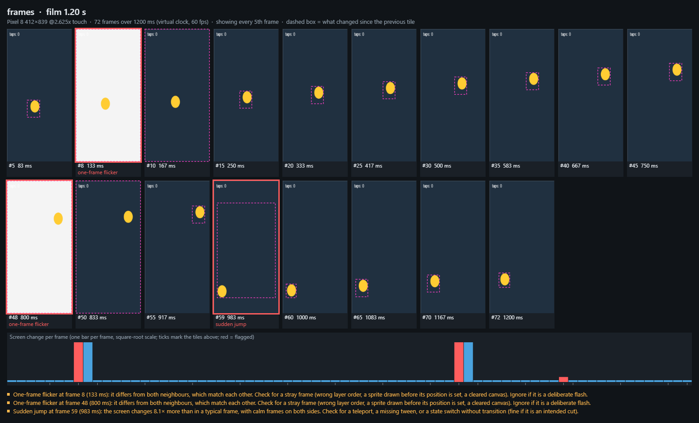
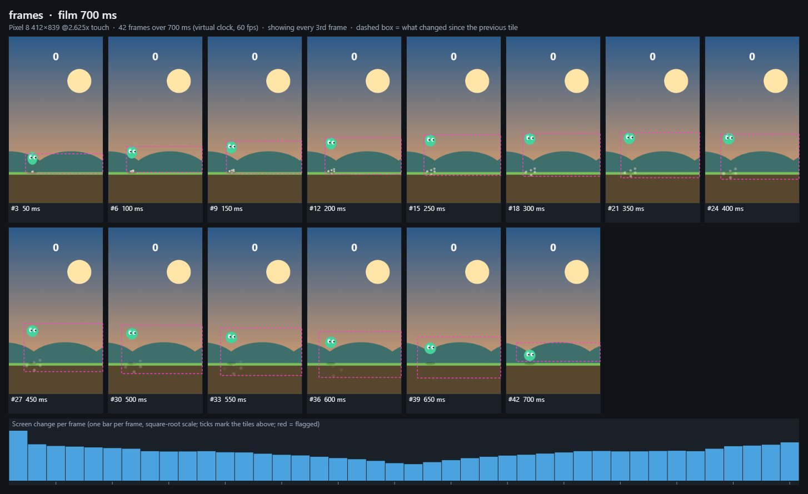
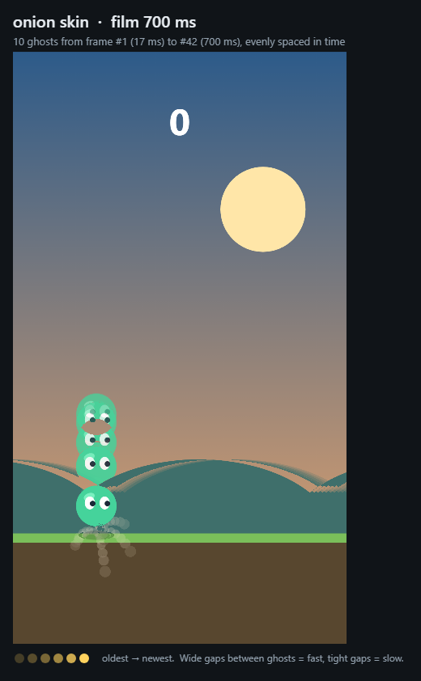
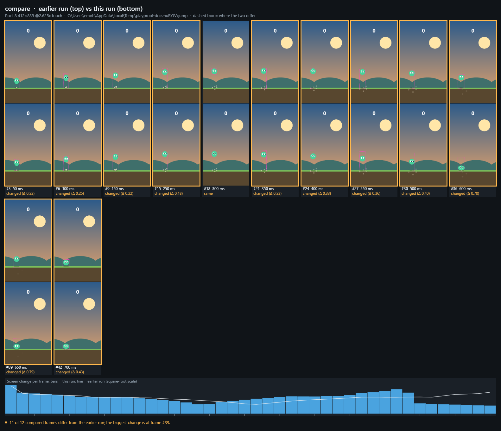
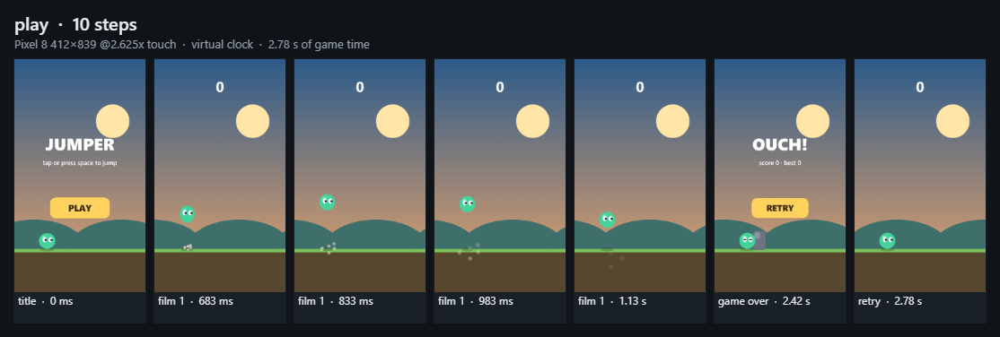
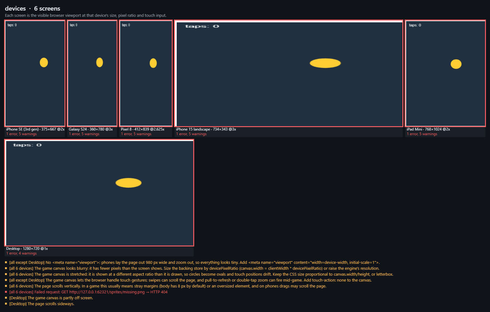
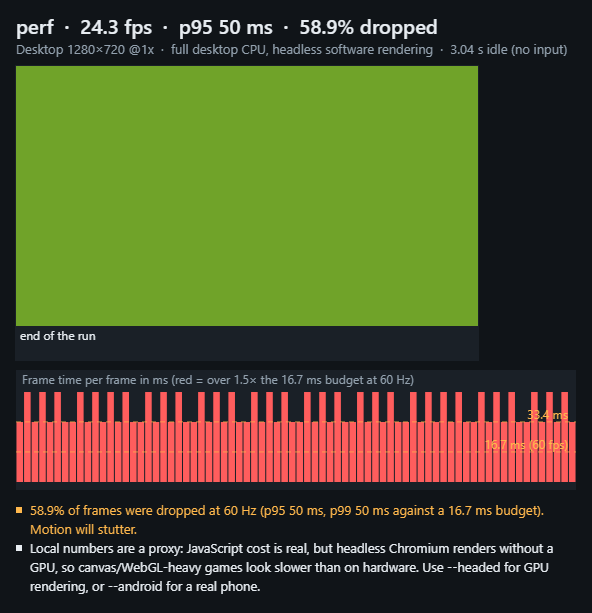

<div align="center">



# playproof

**Eyes and hands for browser games.**

[](https://www.npmjs.com/package/playproof)
[](https://github.com/EmirhanOzl/playproof/actions/workflows/ci.yml)
[](LICENSE)
[](https://nodejs.org)

</div>

Coding agents can write a web game in minutes, but they can't watch it move. playproof lets them (and you) see a game frame by frame, play it with scripted input, hunt for crashes, check it on phone screens and measure how smoothly it runs, on desktop or on a real Android phone. Everything comes back as images made to be read, with a short summary that points at what looks wrong.



Tested with Canvas 2D, WebGL, Phaser, PixiJS and three.js. Anything else that runs in Chromium should work the same way, including Godot and Unity web exports and plain DOM games.

## Install

### Ask your agent

Paste this into Claude Code, Codex, Cursor, Gemini CLI or any other coding agent:

```text
Install playproof from https://github.com/EmirhanOzl/playproof
```

It will pick the right command below for itself.

### Claude Code

```bash
claude plugin marketplace add EmirhanOzl/playproof
claude plugin install playproof@playproof
```

### Codex

```bash
codex plugin marketplace add EmirhanOzl/playproof
codex plugin add playproof@playproof
```

### Gemini CLI

```bash
gemini extensions install https://github.com/EmirhanOzl/playproof
```

### Cursor, OpenCode, GitHub Copilot and other agents

```bash
npx skills add EmirhanOzl/playproof
```

### Claude Desktop and other MCP apps

For apps that call tools instead of running commands, playproof is also an MCP server whose tools return the images directly. Add it to the app's MCP config:

```json
{
  "mcpServers": {
    "playproof": { "command": "npx", "args": ["-y", "playproof", "mcp"] }
  }
}
```

### Without an agent

Nothing to install. Run it with `npx`, pointing it at a dev server, a build folder or an HTML file:

```sh
npx playproof frames http://localhost:5173 --device "Pixel 8" --do "tap 50%,50%" --duration 1s
```

playproof uses your installed Chrome or Edge. `npx playproof install-browser` downloads its own Chromium if you prefer.

## Why

A screenshot catches one random instant, so the things that make a game feel broken stay invisible: a jump without anticipation, a sprite that teleports, a one-frame flicker, a button that does nothing, a crash after a hundred taps, a canvas that is blurry on every phone.

playproof runs the game on a **virtual clock**. Time only moves when playproof moves it, one exact frame at a time, so it can film any moment and every run gives the same pixels. Then it lays the frames out where a model (or a person) can actually look at them. Because runs repeat exactly, an agent can film a motion, change the code, film it again and see precisely what its change did.

## What it does

### `frames`: watch an animation

Films the game frame by frame and builds a contact sheet: dashed boxes show what changed since the previous tile, and the bar chart shows how much of the screen changed in every frame. playproof flags **sudden jumps** (teleports, missing tweens), **one-frame flicker** (draw-order bugs, half-updated state), **holds** (stalls) and **nothing moving at all**.

```sh
npx playproof frames ./dist --device "Pixel 8" --do "tap @Play; wait 400ms; key Space" --duration 700ms
```



Add `--animate` to also get the film as an animated PNG at real speed, to watch it yourself or drop into a pull request. Add `--zoom auto` when the thing that moves is small: playproof captures at full device resolution and crops every frame to where most of the motion happens, so a character's squash and stretch fill the tiles.

It also draws an **onion skin**: the whole motion in one picture, oldest moments faintest. The gaps between the ghosts are the easing (wide gaps are fast, tight gaps are slow), which is exactly what animators look at to judge an arc, an anticipation or an overshoot.



### `frames --compare`: see what a change did

Film, change the code, film again with `--compare <earlier run>`. Every sampled frame of the earlier run sits above the same frame now, with the differences outlined, and the earlier run's motion is drawn as a line over the new bars. Because runs are deterministic, "identical" means identical.

```sh
npx playproof frames http://localhost:5173 --do "tap @Play; key Space" --out .playproof/before
# ...change the jump...
npx playproof frames http://localhost:5173 --do "tap @Play; key Space" --compare .playproof/before
```



### `play`: run a script, get a storyboard

```sh
npx playproof play http://localhost:5173 --device "Pixel 8" \
  --do "shot title; tap @Play; wait 400ms; key Space; film 600ms; until window.playproof.state().screen === 'over' 20s; shot game over; tap @Retry; shot retry"
```



### `monkey`: random play that hunts for crashes

Taps, drags, long presses, rapid triple taps, keys, and sending the tab to the background, all at random but **repeatable by seed**. It reports uncaught errors, failed requests, hangs (infinite loops), soft-locks (input keeps coming, nothing changes) and a render loop that stops. Every error comes with a command that reproduces it exactly.

```sh
npx playproof monkey ./dist --device "Pixel 8" --steps 300
```

```
ERROR   Uncaught error: TypeError: Cannot read properties of undefined (reading 'activate')
        during: action 13: tap 699,820, wait 119ms
        at HTMLCanvasElement.<anonymous> (http://127.0.0.1:52009/:51:40)
        Reproduce: playproof monkey "./dist" --seed 1 --steps 13 --device "Pixel 8"
```

### `devices`: phones, tablet and desktop side by side

Loads the game on nine screens and checks for the layout bugs that only show up there: **blurry canvas** (no devicePixelRatio scaling), **stretched canvas**, canvas cut off, page scrolling, missing viewport meta, missing `touch-action: none`, clipped text and tiny touch targets. The same problem on several devices is reported once.

```sh
npx playproof devices http://localhost:5173
```



### `perf`: frame pacing, locally or on a real phone

Measures real frame times while the game idles, runs a script (`--do`) or takes random taps (`--monkey`): fps, p95/p99, dropped frames against the display's refresh rate, long main-thread tasks and heap growth. Locally the CPU is slowed 4× to approximate a mid-range phone. With `--android` it measures **Chrome on a USB-connected Android phone**; localhost is forwarded to the phone automatically.

```sh
npx playproof perf ./dist --duration 10s --monkey
npx playproof perf http://localhost:5173 --android
```



On a phone, playproof opens its own tab, talks only to that tab and closes it afterwards. It never lists or reads your other tabs.

## Scenarios and `check`: snapshot tests for motion

Put the game's defaults and the moments worth watching in `playproof.config.json` (your editor autocompletes it from the [schema](schema/config.schema.json)):

```json
{
  "$schema": "https://unpkg.com/playproof/schema/config.schema.json",
  "target": "http://localhost:5173",
  "device": "Pixel 8",
  "scenarios": {
    "title": { "duration": "800ms" },
    "jump": { "do": "tap @Play; wait 400ms; key Space", "duration": "700ms", "zoom": "auto" }
  },
  "check": { "monkey": { "steps": 200 }, "devices": true }
}
```

Then the target can be left out, and `--scenario jump` replaces the whole step list:

```sh
npx playproof frames --scenario jump
```

`playproof check` films every scenario and compares it with its baseline in `playproof-baselines/`, then runs `monkey` and `devices`. The first run writes the baselines (commit them). After that, any change to how a scenario moves fails the check with a `compare.png` that shows exactly what changed, until you accept it with `--update`. Baselines are kept per operating system, because fonts and anti-aliasing differ between them.

```sh
npx playproof check                 # everything
npx playproof check --only jump     # one scenario
npx playproof check --update        # accept the current motion
```

### In CI

```yaml
- uses: actions/checkout@v7
- uses: EmirhanOzl/playproof@v0
  with:
    start: npm run preview
    wait-for-url: http://localhost:4173
```

The action installs Chromium, runs `playproof check` (or any command via `command` and `args`), writes the summary to the job page and uploads the images as an artifact. Generate the Linux baselines once in CI (the first run writes them; download them from the artifact or run `--update` there) so they match the machine that checks them.

## Steps

Used by `--do` and `--script <file>` (one step per line there). Separate steps with `;`. Points are relative to the game area (the largest canvas, or `--area <selector>`).

| Step | Meaning |
|---|---|
| `wait 500ms` | let time pass (instant and exact on the virtual clock) |
| `tap 50%,80%` / `tap 120,300` / `tap @Play` | tap or click; `@label` uses targets the game exposes |
| `press 50%,50% 800ms` | long press |
| `drag 10%,50% 90%,50% 300ms` | swipe |
| `key Space [200ms]` | press a key (held 50 ms by default) |
| `type hello` | type text |
| `click #start` | click a DOM element |
| `shot [label]` | screenshot for the storyboard |
| `film 1s [30]` | capture frames while time passes |
| `until <js> [5s]` | advance time until the expression is true |
| `js <js>` | evaluate and log a value |

Times: `500`, `500ms`, `1.5s`.

## Optional: a hook in your game

None of this is required, but four small functions make tests sharper:

```js
window.playproof = {
  ready: () => assetsLoaded,               // boolean, function or promise: when to start
  state: () => ({ screen, level, score }), // logged; used to tell a soft-lock from a busy screen
  targets: () => [{ x, y, width, height, label: "Play" }], // CSS px; enables "tap @Play" and aims the monkey at buttons
  area: () => ({ x, y, width, height }),   // the game world inside a letterboxed canvas; crops every capture
};
```

Without it, use `--ready "<js expression>"` or `--wait-for <selector>` to wait for loading, and percentages for taps. [examples/jumper](examples/jumper/index.html) shows the hook in a complete game.

## How it works

- **Virtual clock.** Before any game script runs, playproof replaces `requestAnimationFrame`, `setTimeout`/`setInterval`, `performance.now` and `Date`, and stops the CSS animation timeline. Time starts frozen. Advancing it runs timers and frames in exact order at 60 fps, which is why `wait 2s` takes milliseconds and why two runs produce identical frames.
- **Repeatable loading.** While the page loads, playproof advances frames itself. Whenever the game has network requests in flight, virtual time waits for them, so to the game the network looks instant and a slow connection gives the same frames as a fast one.
- **Seeded randomness.** `Math.random` is seeded (`--seed`, or `--seed off`).
- **Real input.** Touch devices get real touch events (with the pointer and mouse events Chrome derives from them); others get mouse events. Key presses are held for a few frames so games that poll input see them.
- **Images, not logs.** Contact sheets, onion skins, storyboards and charts are drawn in a blank Chromium page, so playproof has a single dependency (`playwright-core`) and no native image libraries.

## Output

Each run writes to `.playproof/<time>-<command>/` (or `--out <dir>`): the images, `report.json` with all the numbers (per-frame motion, step log, frame times), `summary.txt`, and the sampled frames in `tiles/` for later comparisons. Add `.playproof/` to your `.gitignore`. `--json` prints the report instead of the summary.

Exit codes: `0` nothing serious found, `1` errors found (crashes, failed requests, failed steps, frame drops on a real phone), `2` playproof itself could not run. That makes `monkey` and `devices` usable as CI checks.

## Requirements

- Node.js 22.18 or newer.
- A Chromium-based browser: your installed Chrome or Edge, or `npx playproof install-browser`. Pick one with `--browser chromium|chrome|msedge|<path>`.
- For `perf --android`: `adb` (Android platform-tools), a phone with USB debugging allowed, the screen on and unlocked.

## Limitations

- Audio, video, Web Workers and WebAssembly threads keep real time; a game whose simulation runs in a worker will not be frame-exact.
- Local `perf` numbers come from emulation without a GPU: good for comparing before and after a change, not for promising a frame rate. Use `--headed` for GPU rendering or `--android` for the real thing.
- Motion findings are heuristics. A sudden jump may be an intended cut and a one-frame flash may be a deliberate hit flash, which is why they are worded as things to look at.
- Chromium only, for now.

## Development

```sh
npm install
node src/cli.ts install-browser   # once
npm run check                     # type check + unit and end-to-end tests
npm run docs:images               # regenerate the README images with playproof itself
```

The two example games are also the test targets: [examples/jumper](examples/jumper/index.html) is a small, clean game; [examples/buggy](examples/buggy/index.html) has eight planted bugs that the tests expect playproof to catch.

Issues and pull requests are welcome. See [CONTRIBUTING.md](CONTRIBUTING.md).

## License

MIT
